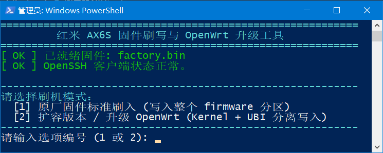
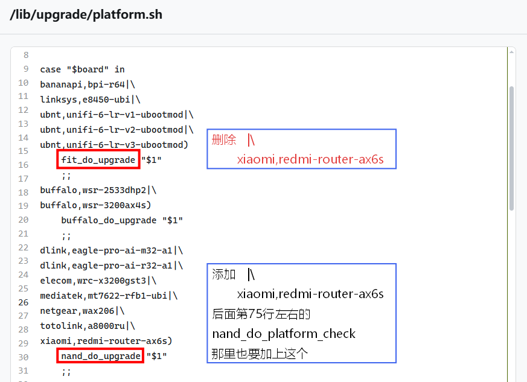

# 红米 AX6S 刷入 KWRT/OpenWrt 记录

> **声明**
> 本文内容整理自个人实践、网络资料及 AI 辅助分析，仅供参考，不保证完全正确。
> 写于：2026-11-03

## 一、刷机步骤

### 1. 刷机流程

#### 第一步：刷入小米 1.2.7 内测版

参考以下教程，完成小米 1.2.7 内测版固件刷入，利用sn码计算并准备好root密码，并确认路由器能够正常启动：

- [红米 AX6S 解锁 SSH 并刷入 OpenWrt](https://openwrt.ai/%e7%ba%a2%e7%b1%b3ax6s-%e8%a7%a3%e9%94%81ssh-%e5%88%b7openwrt%e6%95%99%e7%a8%8b/)

#### 第二步：准备文件

重命名factory包为 `factory.bin`，下载文件 `flash_ax6s.ps1`，将两个文件放在同一文件夹中：

```text
factory.bin
flash_ax6s.ps1
```

同时确保电脑可以联网（手机 USB 共享网络或 Wi-Fi 热点均可）。

#### 第三步：打开 PowerShell

可通过以下任意方式在文件所在文件夹内打开 PowerShell：

- 1.在空白处按住**Shift**键并右键，选择“在此处打开 PowerShell”
- 2.在资源管理器地址栏输入：

```powershell
powershell
```

然后按回车键

#### 第四步：允许脚本执行

在 PowerShell 中执行：

```powershell
Set-ExecutionPolicy RemoteSigned -Scope Process -Force
```

#### 第五步：运行刷机脚本

执行以下命令：

```powershell
./flash_ax6s.ps1
```

按照脚本提示进行操作即可。

---

### 2. 一键刷机脚本说明

由于刷机过程中存在大量重复操作，因此编写了一键刷机脚本 `flash_ax6s.ps1` 用于自动完成常见流程。



#### 运行环境

- Windows 10
- PowerShell  5.1

#### 功能说明

#### 功能 1：首次刷入 OpenWrt/KWRT

从小米 1.2.7 内测版固件刷入 `factory.bin` 固件。相关机制可见后文附录1。

#### 功能 2：升级 OpenWrt

在已运行 OpenWrt 的情况下刷入新版 `factory.bin` 固件，例如：`24.12 → 25.12`版本升级。相关机制可见后文附录2。

## 二、遇到的问题

### 1. 刷入小米 1.2.7 内测版偶发失败

现象：

- 使用小米刷机工具刷入 1.2.7 内测版时偶尔失败。

原因：

- 笔记本网口有部分针脚变形。
- 当时使用 USB 转有线网卡连接路由器进行刷机。
- 修复网口后，改用笔记本自带网口连接即可正常刷入。

推测：

- 刷机工具可能选择了错误的网络适配器。

---

### 2. 小米1.2.7内测版刷入 OpenWrt 25.12 的 Factory 固件失败

报错信息：

```bash
root@XiaoQiang:\~# mtd -r write /tmp/k-factory.bin firmware
Unlocking firmware ...
Writing from /tmp/k-factory.bin to firmware ...
[e] Failed to get erase block status
```

原因：

- `factory.bin` 文件大小超过 30 MB。

解决方法：

- 使用 KWRT 在线精简软件数量后的定制镜像。
- 将 `factory.bin` 控制在 27 MB 左右后成功刷入。

---

### 3. LuCI 后台报错 `module 'luci.netstat' not found`

报错信息：

```text
module 'luci.netstat' not found
```

现象：

- 刷入 Factory 固件后无法正常进入 Web 管理界面。
- SSH 可以正常连接。

解决方法：

- 通过 SSH 安装 `luci-app-netstat`；
- 或移除相关依赖后进入后台；
- 推荐直接安装 `luci-app-netstat`；
- 构建镜像时可提前加入 `luci-app-netstat` 软件包。

---

### 4. Sysupgrade 固件升级失败

通过 LuCI 升级 `sysupgrade.bin` 时出现如下报错：

```bash
不支持已上传的文件，请选择适合当前硬件的固件文件。
固件文件校验失败：
Mon Nov 2 09:47:13 CST 2026 upgrade:
The device is supported, but this image
is incompatible for sysupgrade based on the image version (2.0->1.0).
Invalid image type.
Image check failed.
```

---

## 三、Sysupgrade 失败原因分析

### 四层校验连环失败

一次正常的 Sysupgrade 升级需要依次通过以下四个阶段：

`格式识别`
↓
`platform_check_image`
↓
`fwtool 元数据匹配`
↓
`platform_do_upgrade`

本次升级过程中四个阶段均存在问题。

| 关卡 | 预期 | 实际 | 结果 |
| -------- | -------- | -------- | -------- |
| 格式识别 | AX6S 为 FIT 设备，应使用 FIT/ITB 镜像（`d00dfeed` 开头） | 实际构建的是 `sysupgrade-tar` | 镜像类型不匹配 |
| 镜像校验 | `platform_check_image\` 应调用 `nand_do_platform_check` | 实际进入 `fit_check_image` | `Invalid image type` |
| 元数据校验 | `device_list` 与本机 Board Name 一致 | Metadata 中设备名不匹配 | `fwtool_device_match: false` |
| 升级执行 | 应进入 `nand_do_upgrade` | 实际进入 `fit_do_upgrade` | 升级路径错误 |

### 总结

KWRT 构建 AX6S 镜像时使用了：`sysupgrade-tar`，而设备侧的：`/lib/upgrade/platform.sh`仍然按照 FIT 设备进行校验和升级。

因此出现：

```text
打包格式 ≠ 校验逻辑 ≠ 升级逻辑
```

导致整个升级流程无法通过校验。即使强制升级，也会因为将 TAR 镜像按照 FIT/ITB 镜像方式处理而失败。

---

## 四、解决办法

### 方法一：启动脚本自动修复（推荐）

进入：`系统 → 启动项 → 本地启动脚本`

添加以下内容：

```bash
# 仅在 compat_version 不是 1.0 时才设置
if [ "$(uci get system.@system[0].compat_version 2>/dev/null)" != "1.0" ]; then
    uci set system.@system[0].compat_version='1.0'
    uci commit system
fi
# 仅在 platform.sh 未被修改时才执行sed
if grep -q 'xiaomi,redmi-router-ax6s)' /lib/upgrade/platform.sh; then
    sed -i '/xiaomi,redmi-router-ax6s)/c\    ubnt,unifi-6-lr-v3-ubootmod)' \
        /lib/upgrade/platform.sh
    sed -i '/totolink,a8000ru)/i\
    xiaomi,redmi-router-ax6s|\\' \
        /lib/upgrade/platform.sh
fi
```

保存并重启路由器后，即可在 Web 界面正常升级固件。

---

### 具体处理过程

#### 1. 修改 `platform.sh`

将：

```text
xiaomi,redmi-router-ax6s
```

加入：

```text
platform_check_image
platform_do_upgrade
```

对应的 NAND 设备列表中，使其走：

```text
nand_do_platform_check
nand_do_upgrade
```

而不是 FIT 升级路径。



#### 2. 校验脚本语法

```bash
sh -n /lib/upgrade/platform.sh
```

确认：

- 仅命中 NAND 两处配置；
- FIT 设备组中不再包含 AX6S。

#### 3. 重新验证镜像

```bash
/usr/libexec/validate_firmware_image /tmp/update.bin 2>&1 | tee /tmp/validate.log
```

结果：

- 镜像校验通过；
- 但 `fwtool_device_match` 仍显示为 `false`。

#### 4. 强制刷入 Sysupgrade

```bash
sysupgrade -F -n -v /tmp/sysupgrade.bin
```

参数说明：

| 参数 | 作用 |
| ---------- | ------------------------ |
| `-F` | 跳过 fwtool 元数据校验 |
| `-n` | 不保留配置 |
| `-v` | 输出详细日志 |

刷写成功。

#### 5. 修改 compat_version

如果希望：

- Web 界面不再报错；
- 能够正常上传 Sysupgrade 固件；

则需要同步当前系统的 `compat_version`：

```bash
uci set system.@system[0].compat_version='1.0'
uci commit system
```

### 本次兼容性修复总结

我这次遇到的问题，已发邮件给kwrt，如果问题得到修复，则**本地启动脚本**中的代码记得移除

```txt
一、web界面报错”module 'luci.netstat' not found“
通过在编译时加入软件”luci-app-netstat“解决。

二、更新sysupgrade.bin报错
“upgrade: The device is supported, but this image
is incompatible for sysupgrade based on the image version (2.0->1.0).
Invalid image type. Image check failed.”
是因为在线构建了sysupgrade-tar（`kernel`+`root`UBI 镜像），而不是fit/itb，要不修改构建
打包的问题，要不就在构建目录的 package/base-files/files/lib/upgrade/platform.sh中，直接
将 xiaomi,redmi-router-ax6s 写入对应 NAND 升级组的白名单函数中，并移除fit中的xiaomi,redmi-router-ax6s。

三、对齐版本号： 检查 Makefile 或默认配置文件，确保编译出的 compat_version 保持一致（统一为 1.0或2.0）。

四、factory.bin包大小
由小米内测版1.2.7刷写固件时，受限于firmware大小，构建的factory包不要超过30MB
```

---

## 附录 1：分区机制研究

原厂固件与 OpenWrt 的分区情况可通过以下命令查看：

```bash
cat /proc/mtd
```

该命令会列出系统当前识别到的 MTD（Memory Technology Device）分区信息，包括分区名称、大小及擦除块大小。

---

### 1. 小米原厂固件 MTD 分区表（15 分区结构）

原厂固件采用典型的 A/B 双系统设计。

其中：

- `firmware` 为当前运行固件；
- `firmware1` 为备用固件；
- `kernel` 与 `rootfs` 逻辑上属于 `firmware`；
- `overlay` 用于存储用户数据与扩展软件；
- `obr` 用于出厂恢复。

原厂固件中，`mtd9 (firmware)` 逻辑上包含：

```text
firmware
├── kernel
└── rootfs
```

同时保留一个大小相同的 `firmware1` 分区用于升级失败时回滚。

| 分区名 | 大小 | 用途 |
| --------- | --------- | --------- |
| `PL_Header` | 128 KB | Flash 头信息及启动描述数据 |
| `Preloader` | 384 KB | 联发科预加载程序，负责 DRAM 初始化 |
| `ATF` | 256 KB | ARM Trusted Firmware |
| `uboot` | 512 KB | 原厂 U-Boot 引导程序 |
| `Nvram` | 256 KB | 原厂环境变量与网络参数 |
| `Bdata` | 256 KB | 启动标志、SSH 状态及设备信息 |
| `Factory` | 512 KB | MAC 地址、无线校准参数等出厂数据 |
| `crash` | 256 KB | 崩溃状态记录 |
| `crash_log` | 256 KB | 崩溃日志存储区 |
| `firmware` | 30 MB | 主系统固件 |
| `kernel` | 2.625 MB | Linux 内核 |
| `rootfs` | 27.375 MB | 根文件系统 |
| `firmware1` | 30 MB | 备用系统 |
| `overlay` | 50 MB | 用户数据与插件空间 |
| `obr` | 5 MB | 出厂恢复镜像（Out-of-box Recovery） |

---

### 2. OpenWrt 分区表（重构后的结构）

刷入 OpenWrt 后，系统会重新组织高地址区域的存储空间。

原厂保留下来的启动和校准相关分区不会变化，而原先用于双系统和恢复系统的大量空间会被整合为统一的 UBI 存储池。

典型结构如下：

| MTD 设备 | 分区名称 | 大小 | 功能说明 |
| --------- | --------- | --------- | --------- |
| `mtd0` | Preloader | 0.50 MB | BootROM 加载的预启动程序 |
| `mtd1` | ATF | 0.25 MB | ARM Trusted Firmware |
| `mtd2` | u-boot | 0.50 MB | 原厂 U-Boot |
| `mtd3` | u-boot-env | 0.25 MB | U-Boot 环境变量 |
| `mtd4` | bdata | 0.25 MB | 设备关键参数 |
| `mtd5` | factory | 0.50 MB | Wi-Fi 校准数据 |
| `mtd6` | crash | 0.25 MB | 崩溃标志区 |
| `mtd7` | crash_log | 0.25 MB | 崩溃日志区 |
| `mtd8` | kernel | 6.00 MB | FIT 镜像及引导加载器 |
| `mtd9` | ubi | 109 MB | OpenWrt UBI 管理卷 |

> 实际大小和分区名称应以设备当前 `/proc/mtd` 输出结果为准。

---

### 3. 固件分区重构的技术机制

#### 3.1 链式引导架构

为了降低刷机风险，OpenWrt 并不会替换底层 Preloader 和原厂 U-Boot，而是采用链式引导（Chain Loading）方式启动。

原厂启动流程如下：

```text
BootROM
    ↓
Preloader
    ↓
ATF
    ↓
U-Boot
    ↓
Kernel
    ↓
RootFS
```

刷入 OpenWrt 后，前半部分保持不变：

```text
BootROM
    ↓
Preloader
    ↓
ATF
    ↓
原厂 U-Boot
    ↓
ubi-loader.itb
    ↓
主线 U-Boot
    ↓
UBI
    ↓
Linux Kernel
    ↓
RootFS
```

原厂 U-Boot 依然从固定位置加载镜像，但加载对象已经不再是传统 Linux Kernel，而是 OpenWrt 提供的 `ubi-loader.itb`。

随后由主线 U-Boot 接管系统，并从 UBI 卷中载入 OpenWrt 系统完成启动。

---

#### 3.2 统一 UBI 卷的构建

原厂固件存在大量空间碎片化问题：

| 分区 | 大小 |
| --------- | --------- |
| firmware | 30 MB |
| firmware1 | 30 MB |
| overlay | 50 MB |
| obr | 5 MB |

这些空间用途固定。

对于只运行单套系统的用户而言，大量空间长期处于闲置状态。

因此 OpenWrt 将这些空间整合为统一的 UBI 卷：

```text
UBI
├── rootfs
├── rootfs_data
└── 其他动态卷
```

UBI 具备以下能力：

- 坏块管理（Bad Block Management）
- 磨损均衡（Wear Leveling）
- 动态卷分配
- 自动空间扩展

相比原厂固件，用户可获得更大的可用存储空间。

---

#### 3.3 保留关键校准数据

在重构过程中，以下两个关键分区始终保持不变：

##### bdata

```text
地址范围：
0x00180000 - 0x001C0000
```

用于保存：

- 设备序列号（S/N）
- 校验信息
- 加密数据
- 启动状态

##### factory

```text
地址范围：
0x001C0000 - 0x00240000
```

用于保存：

- MAC 地址
- Wi-Fi EEPROM 数据
- 射频校准参数
- 天线配置参数

OpenWrt 启动时，`mt76` 无线驱动会直接读取 `factory` 分区中的校准数据。

因此：

> `bdata` 和 `factory` 是整个设备最重要的两个数据分区，除非已经完成备份，否则不要擦除或覆盖。

由于这两个分区的物理地址与原厂固件保持一致，因此 OpenWrt 在重构分区表时无需修改其中内容，从而保证设备标识和无线性能不会受到影响。

## 附录 2：从旧版 OpenWrt 迁移至新版分区布局固件

部分早期版本（如部分 OpenWrt 23.05 系列或更早版本）仍采用旧版分区布局，其中 `kernel` 分区大小约为 2.625 MB。

而较新的 AX6S 固件采用了扩展后的分区布局，`kernel` 分区被扩大至约 6 MB，并重新规划后续 UBI 区域。

因此，对于仍运行旧版分区布局的系统，如果直接在 LuCI 中上传新版固件进行升级，可能导致升级失败、无法启动或出现分区布局不一致等问题。

---

### 判断 Factory 镜像中 Kernel/FIT 部分大小

对于 AX6S 当前使用的 NAND 架构固件，Factory 镜像通常由以下两部分连续组成：

```text
Factory.bin
├── Kernel / FIT 区域
└── UBI 区域
```

可以通过查找 UBI 魔数 `UBI#` 的位置，判断 UBI 区域的起始偏移，从而推算前部 Kernel/FIT 区域的大小。

在 PowerShell 中执行：

```powershell
$bytes = [System.IO.File]::ReadAllBytes("factory.bin")
$pattern = [System.Text.Encoding]::ASCII.GetBytes("UBI#")

for ($i = 0; $i -lt ($bytes.Length - 4); $i++) {
    if (
        $bytes[$i] -eq $pattern[0] -and
        $bytes[$i+1] -eq $pattern[1] -and
        $bytes[$i+2] -eq $pattern[2] -and
        $bytes[$i+3] -eq $pattern[3]
    ) {
        Write-Host "=========================================="
        Write-Host "发现 UBI 标志，偏移位置：$i 字节"
        Write-Host "=========================================="
        break
    }
}
```

脚本输出的偏移量即为 UBI 部分的起始位置，通常也对应 Factory 镜像中 Kernel/FIT 部分的大小。

---

#### 跨版本迁移流程

1. 通过 SSH 登录路由器。
2. 将适用于目标版本的 Factory 镜像上传到 `/tmp/`。
3. 将镜像重命名为：

```text
factory.bin
```

1. 根据当前系统实际分区布局，按照 Kernel 与 UBI 边界分别写入。

示例：

```bash
mount -o remount,ro /
mount -o remount,ro /overlay

cd /tmp

dd if=factory.bin bs=1M count=4 | mtd write - kernel
dd if=factory.bin bs=1M skip=4 | mtd -r write - ubi
```

---

#### 参数说明

```bash
dd if=factory.bin bs=1M count=4
```

表示：

- 从 `factory.bin` 开始读取；
- 每次读取 1 MB；
- 共读取前 4 MB；
- 写入 `kernel` 分区。

```bash
dd if=factory.bin bs=1M skip=4
```

表示：

- 跳过前 4 MB；
- 读取剩余内容；
- 写入 `ubi` 分区。

其中：

```text
count = 当前系统 kernel 分区大小（MB）
skip  = 当前系统 kernel 分区大小（MB）
```

二者必须保持一致。

实际数值应根据当前系统的分区结构进行调整。

---

#### 示例说明

假设当前系统采用旧布局：

```text
kernel = 4 MB
ubi    = 后续全部空间
```

而目标固件采用新布局：

```text
kernel = 6 MB
ubi    = 后续全部空间
```

此时可通过上述方式，将 Factory 镜像作为连续二进制流分别写入当前系统的 `kernel` 与 `ubi` 分区。

完成刷写并重启后，新系统即可按照新版分区布局启动。

最终结果应以系统启动后的：

```bash
cat /proc/mtd
```

输出结果为准。

---

## 附录 3：其他机制

### 一、U-Boot TFTP 救砖机制

当刷机过程中出现异常，导致设备无法正常启动（例如橙灯常亮、无法进入系统）时，可以利用原厂 U-Boot 提供的 TFTP 恢复模式恢复原厂固件。

---

#### 第一步：配置本地网络

将电脑有线网卡设置为：

```text
IP 地址：192.168.31.100
子网掩码：255.255.255.0
```

然后使用网线将电脑与路由器 LAN 口直连。

---

#### 第二步：配置 TFTP 服务

启动 TFTP 服务程序，例如：

- tftpd64
- 小米官方救机工具

将原厂固件重命名为：

```text
C0A81F02.img
```

并放入 TFTP 根目录。

其中：

```text
C0A81F02
=
192.168.31.2
```

对应的十六进制编码。

同时应：

- 指定绑定网卡为 `192.168.31.100`
- DHCP 起始地址设置为 `192.168.31.2`
- DHCP 池大小设置为 1

---

#### 第三步：进入恢复模式

1. 断开路由器电源。
2. 按住 Reset 键不放。
3. 接通电源。
4. 持续按住约 10 秒。

当指示灯由常亮橙灯变为快速闪烁橙灯后松开。

---

#### 第四步：自动恢复

进入恢复模式后，原厂 U-Boot 会放弃引导当前系统，并从网络获取恢复镜像。

恢复成功后通常会出现：

```text
蓝灯快速闪烁
```

随后重新上电即可恢复原厂系统。

> 实际操作时，直接使用小米官方救机工具按照教程执行即可。

### 二、Factory 固件（首刷包 / 救砖包）

#### Sysupgrade 固件的定义与使用场景

Factory 固件主要用于以下场景：

- 从原厂固件首次刷入 OpenWrt；
- 使用原厂 Web 管理界面升级固件；
- 使用厂商专用升级工具刷机；
- TFTP 救砖恢复。

其核心作用是完成从原厂系统到 OpenWrt 系统的首次迁移，因此也常被称为：

```text
首刷包
底包
Factory 镜像
```

---

#### 2. Factory 固件的特点

Factory 固件并不仅仅是 Linux 内核与文件系统的简单组合，其具体结构依赖于设备厂商的实现方式。

通常包含以下部分：

##### 厂商专用头部（Vendor Header）

原厂 Bootloader 或 Web 升级程序通常只接受特定格式的固件。

因此 Factory 镜像中往往包含：

- Magic Number（魔数）
- 校验信息
- 固件版本信息
- 厂商签名

用于通过原厂固件的合法性校验。

##### 分区布局信息

部分厂商要求升级镜像中明确包含：

- 分区偏移
- 分区大小
- 启动信息

因此 Factory 镜像通常会按照设备实际 Flash 布局进行组织。

例如 AX6S 的 Factory 镜像通常表现为：

```text
Factory.bin
├── FIT / Kernel 区域
└── UBI 区域
```

其中前部区域可能会被补齐到预定义大小。

例如：

```text
Kernel 实际大小：4.6 MB
Kernel 分区大小：6 MB
```

剩余空间通常以：

```text
0xFF
```

填充。

##### 面向原厂升级逻辑

Factory 固件的主要目标是兼容原厂升级机制，因此格式设计优先考虑：

```text
原厂系统
   ↓
Factory
   ↓
OpenWrt
```

而不是 OpenWrt 内部的升级流程。

---

### 三、Sysupgrade 固件（系统升级包）

#### 1. 定义与使用场景

Sysupgrade 固件用于 OpenWrt 系统内部升级。

适用于：

- OpenWrt → OpenWrt
- 小版本升级
- 大版本升级
- 自编译固件升级

升级方式通常包括：

- LuCI Web 界面
- SSH 命令行
- 自动升级脚本

例如：

```text
23.05 → 24.x
24.x → 25.x
```

---

#### 2. Sysupgrade 固件的特点

Sysupgrade 固件面向 OpenWrt 的升级框架设计。

其核心目标是：

- 校验设备型号
- 校验兼容性
- 安全写入固件
- 迁移配置文件

---

#### 3. AX6S 的 Sysupgrade 包结构

对于 AX6S 当前使用的 NAND 架构固件，Sysupgrade 镜像通常表现为标准的 TAR 包格式。

解压后一般可看到：

```text
kernel
root
sysupgrade.meta
```

其中：

##### kernel

Linux 内核镜像。

示例：

```text
kernel
kernel.bin
```

##### root

根文件系统镜像。

通常包含：

- BusyBox
- OpenWrt 基础组件
- LuCI
- 驱动程序
- 用户软件包

##### sysupgrade.meta

升级元数据文件。

用于供：

```text
fwtool
sysupgrade
```

进行校验。

常见内容包括：

- compat_version
- board 名称
- device 名称
- SHA256 校验值

例如：

```text
compat_version=1.0
device=xiaomi,redmi-router-ax6s
```

---

#### 4. Factory 与 Sysupgrade 的区别

| 项目 | Factory | Sysupgrade |
| -------- | -------- | -------- |
| 使用场景 | 原厂系统刷入 OpenWrt | OpenWrt 内部升级 |
| 使用对象 | 原厂固件 | OpenWrt |
| 校验方式 | 原厂校验机制 | OpenWrt 校验机制 |
| 是否包含厂商头部 | 通常包含 | 通常不需要 |
| 是否包含升级元数据 | 视设备而定 | 通常包含 |
| 是否用于救砖 | 可以 | 通常不建议 |
| 典型用途 | 首刷 | 日常升级 |

---

### 固件格式总结

简单记忆：

```text
Factory
=
原厂系统 → OpenWrt

Sysupgrade
=
OpenWrt → OpenWrt
```

首刷使用 Factory。

后续升级优先使用 Sysupgrade。

## 附录 4：编译固件与 OPKG 安装的特点及区别

### 一句话结论

编译进固件更适合长期稳定运行的系统，具有**节省空间、减少闪存写入、稳定性高**等优点；

OPKG 安装则更加**灵活、方便测试和后期扩展**，无需重新编译或刷机。

对于绝大多数软件来说，运行后的实际性能并没有明显差别。

---

### 一、核心机制差异

#### 编译进固件的存储方式

在编译阶段通过：

```bash
make menuconfig
```

或：

```text
ImageBuilder
```

将软件包直接集成到固件镜像中。

软件文件最终存放于：

```text
SquashFS RootFS（只读）
```

系统刷入后即可直接使用，无需额外安装。

---

#### OPKG 安装的存储方式

系统启动后，通过：

```bash
opkg update
opkg install
```

从软件源下载 `.ipk` 包。

软件文件最终存放于：

```text
Overlay（可写分区）
```

通常为：

```text
UBIFS
F2FS
EXT4
```

等可写文件系统。

---

#### 一个关键事实

对于 OpenWrt 而言：

```text
可用 Overlay 空间
=
Flash 总容量
− Kernel
− RootFS
```

因此：

- 编译进固件会增大 RootFS；
- OPKG 安装会直接占用 Overlay。

二者本质上都在消耗同一块 Flash 空间，只是占用位置不同。

---

### 二、对比总表

| 维度 | 编译进固件 | OPKG 安装 |
| -------- | -------- | -------- |
| 生效方式 | 编译期集成，刷机后立即可用 | 运行期下载安装 |
| 网络依赖 | 无 | 需要软件源可用 |
| 存储位置 | RootFS（SquashFS） | Overlay |
| 空间利用率 | 高 | 相对较低 |
| 闪存写入 | 不产生额外安装写入 | 安装、升级、卸载均会产生写入 |
| Firstboot 后 | 软件仍然存在 | 软件会丢失 |
| 升级维护 | 需要重新编译或刷机 | 可单独安装、卸载 |
| 内核模块兼容性 | 与固件同步编译，天然匹配 | 必须严格匹配当前内核版本 |
| 调试灵活性 | 较低 | 较高 |
| 适用场景 | 长期运行 | 测试与扩展 |

---

### 三、对 Flash 空间的影响

#### 编译进固件对 Flash 空间的影响

软件被打包到：

```text
RootFS（SquashFS）
```

中。

SquashFS 具有：

- 高压缩率；
- 重复文件共享；
- 全局优化；

因此通常能够以较小空间容纳更多软件。

尤其是在：

```text
16 MB
32 MB
```

这类小容量设备上优势明显。

---

#### OPKG 安装对 Flash 空间的影响

软件安装后直接存储于 Overlay。

特点：

- 文件以实际展开状态保存；
- 无法享受 SquashFS 的整体压缩效果；
- 对 Overlay 空间消耗更明显。

因此相同软件包在 Overlay 中占用的实际空间通常会大于编译进固件后的占用空间。

---

### 四、对 Flash 寿命的影响

#### 编译进固件

刷机完成后：

```text
RootFS 为只读文件系统
```

正常运行期间不会因为软件安装或升级产生额外写入。

因此更适合作为长期稳定运行的方案。

---

#### OPKG 安装

以下操作都会产生 Flash 写入：

```bash
opkg install
opkg upgrade
opkg remove
```

同时 Overlay 还承担：

- 日志写入
- DHCP 租约
- 配置修改
- 系统缓存

等运行时数据存储。

如果 Overlay 长期接近满载，可能导致：

```text
空间不足
软件安装失败
日志写入失败
系统运行异常
```

---

### 五、对运行性能的影响

#### 程序运行速度

绝大多数情况下：

```text
编译进固件
=
OPKG 安装
```

软件启动后都会被加载到内存执行，因此不存在本质性能差异。

---

#### 文件读取性能

两者存在一定差异：

##### SquashFS

优点：

- 压缩率高；
- 实际读取的数据量更少；
- 对 Flash 访问更友好。

缺点：

- 读取时需要 CPU 解压。

---

##### Overlay

优点：

- 无需解压；
- 顺序读取大文件时更直接。

缺点：

- 占用空间较大；
- 文件碎片可能更多。

在现代路由器（如 AX6S）上，这种差异通常很难感知。

---

#### 系统启动

编译进固件的软件能够随系统一起完成挂载和初始化。

合理控制固件体积时，通常对启动速度影响较小。

OPKG 安装的软件也不会显著拖慢启动速度，但会占用更多 Overlay 空间。

---

### 六、选型建议

#### 推荐编译进固件

适用于：

- 驱动程序
- 内核模块
- 网络组件
- WireGuard
- PPPoE
- AdGuardHome
- MosDNS
- Docker 等长期运行服务

特点：

```text
稳定
节省空间
减少维护
```

---

#### 推荐使用 OPKG

适用于：

- 临时测试软件
- 功能验证
- 调试工具
- 偶尔使用的插件

特点：

```text
灵活
方便
无需重新刷机
```

---

#### 个人推荐方案

实际使用中，比较合理的做法是：

```text
基础组件 → 编译进固件

可选组件 → OPKG 安装
```

例如：

```text
固件内：
WireGuard
PPPoE
AdGuardHome
常用 LuCI 插件

Overlay：
临时测试软件
开发工具
抓包工具
```

这样既能保证系统稳定，又能够保留足够的扩展空间。

---

### 七、三个常见误区

#### 1. 老版本软件源失效

旧版本 OpenWrt 可能已经停止维护。

因此：

```bash
opkg update
```

可能出现：

```text
软件源失效
证书错误
找不到软件包
```

等问题。

---

#### 2. 内核模块无法安装

最常见于：

```text
kmod-*
iptables-mod-*
nftables 模块
无线驱动模块
```

这些软件必须严格匹配当前运行内核版本。

否则会出现：

```text
kernel mismatch
```

或模块加载失败。

---

#### 3. Overlay 被占满

大量安装软件后：

```text
df -h
```

可能发现 Overlay 可用空间接近 0。

此时容易出现：

- 日志无法写入；
- 软件安装失败；
- 配置保存失败；
- 系统异常。

因此建议长期保留一定空闲空间，不要将 Overlay 使用到接近满载。

## 附录 5：WireGuard IPv6 异地组网记录

### 问题现象

WireGuard 配置检查无误：

- Peer 配置正确；
- 密钥正确；
- AllowedIPs 正确；
- DDNS 正常解析；
- IPv6 地址可以正常获取。

但两端始终无法建立连接。

---

### 排查结果

问题并不在 WireGuard 配置本身，而是在防火墙配置。

参考了一些针对 IPv4 场景的教程后，额外配置了：

- 端口转发
- NAT
- DNAT

结果反而导致 IPv6 环境下连接异常。

---

### 正确配置方式

对于 IPv6 直连场景：

#### 接口区域

WireGuard 接口直接加入：

```text
lan
```

区域即可。

无需单独创建新的防火墙区域。

---

#### 通信规则

仅需添加一条放行规则：

```text
WAN6
    ↓
路由器
    ↓
WireGuard 监听端口
```

例如：

```text
UDP 51280
```

---

#### 不需要的配置

以下配置通常仅适用于 IPv4：

```text
端口转发
DNAT
NAT
```

IPv6 场景下通常不需要配置。

错误配置反而可能导致连接失败。

---

### 理解 OpenWrt 防火墙区域

为了方便记忆，可以这样理解：

| 名称 | 记忆方法 | 含义 |
| -------- | -------- | -------- |
| 输入（Input） | 站内 | 访问路由器自身 |
| 输出（Output） | 站出 | 路由器主动访问外部 |
| 转发（Forward） | 站转 | 流量经过路由器转发 |

示例：

```text
WAN6
    ↓
路由器
    ↓
UDP 51280
```

属于：

```text
输入（Input）
```

而不是：

```text
Forward
```

因为流量目标是路由器自身。

---

### 通信规则中的“设备”是什么意思

OpenWrt 中的：

```text
目标区域：设备（Device）
```

可以理解为：

```text
路由器自身
```

例如规则：

```text
来源区域：WAN

目标：设备

UDP 51280
```

实际含义就是：

```text
允许访问路由器公网 IPv6 地址的 UDP 51280 端口
```

即访问 WireGuard 服务监听端口。

---

### WireGuard 配置总结

对于 IPv6 直连的 WireGuard 场景：

```text
WireGuard 接口加入 LAN
        ↓
放行 WireGuard UDP 端口
        ↓
完成
```

通常不需要：

```text
端口转发
NAT
伪装（Masquerade）
DNAT
```

如果 DDNS、IPv6 地址和 Peer 配置均正确但仍无法连接，应优先检查防火墙规则是否误用了 IPv4 的配置思路。
